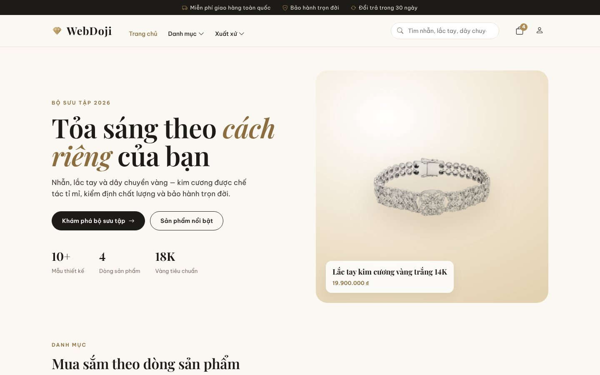
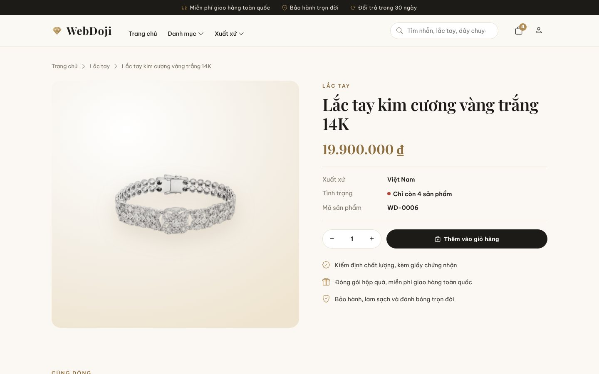
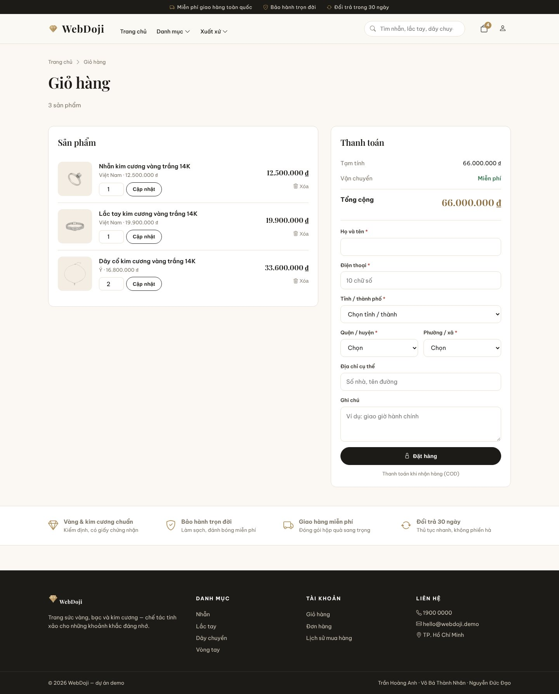
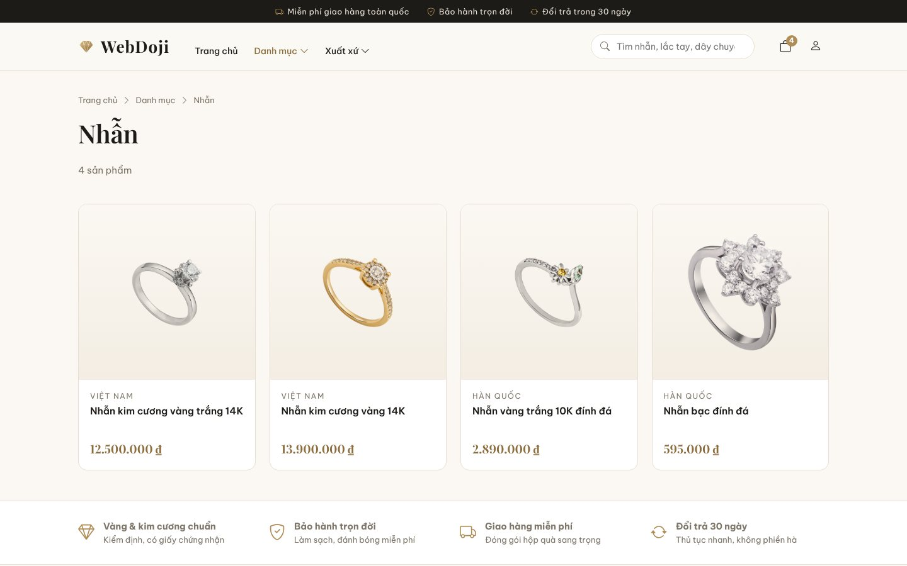
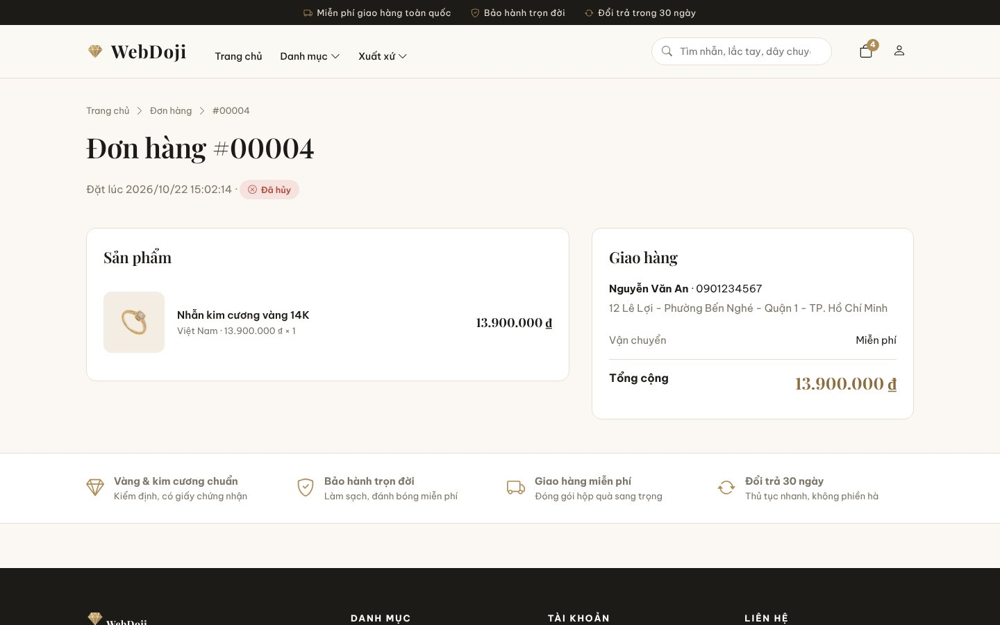
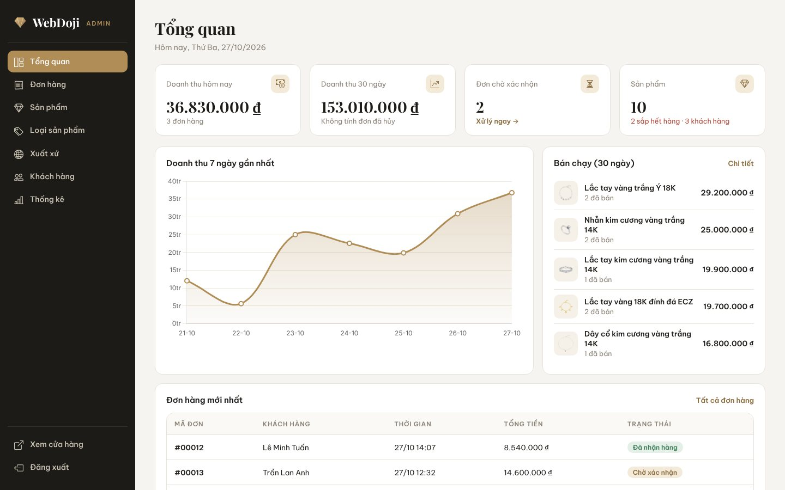
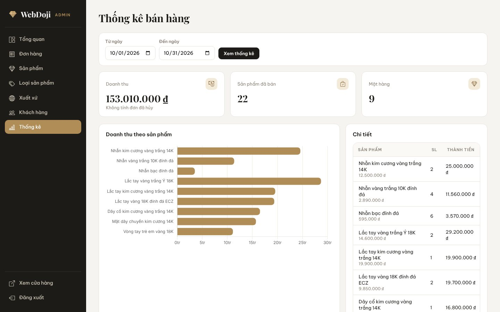
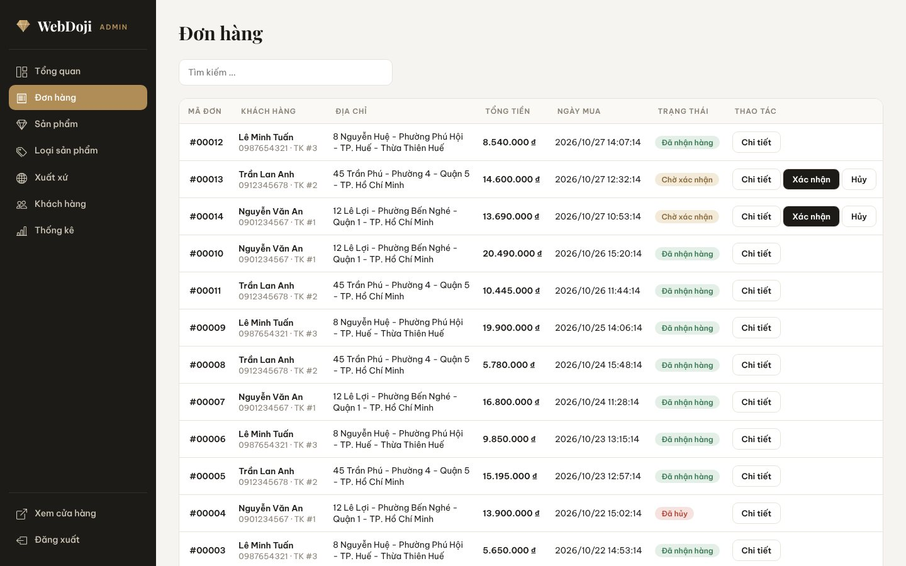

# 💍 WebDoji — Jewelry Store


An online store for gold, silver and diamond jewelry with a customer storefront and a back-office for staff. Server-rendered with Express and EJS on MySQL, styled with a custom ivory-and-gold design system.



| Product page | Cart & checkout |
|---|---|
|  |  |
| **Category listing** | **Order details** |
|  |  |

| Admin dashboard | Sales statistics |
|---|---|
|  |  |
| **Order management** | **Mobile** |
|  |  |

## Features

**Customer** (`/customer`)
- Home page with featured piece, category tiles and per-category collections
- Browse by category or origin, search, product page with stock status and quantity stepper
- Cart with live badge, checkout with province → district → ward picker (cash on delivery)
- Order tracking: current orders, history, order details; cancel a pending order (items return to stock)
- Sign up, log in, change password

**Admin** (`/admin`)
- Dashboard: today's and 30-day revenue, pending orders, low-stock alert, 7-day revenue chart, best sellers, latest orders
- Products, categories and origins: create / edit / delete / show / hide, image upload
- Orders: confirm or cancel (cancelling restocks); customers: view purchases, lock / unlock
- Sales statistics for any date range with charts

## Run locally

Requires Node.js 18+ and MySQL 5.7+/8 or MariaDB.

```bash
git clone https://github.com/hoanganhpy/WebDoji_Nodejs.git
cd WebDoji_Nodejs
npm install

mysql -u root -p < database/schema.sql   # create database and tables
npm run db:seed                          # demo data (wipes existing data)
npm start                                # http://localhost:3000
```

| Role | URL | Username | Password |
|---|---|---|---|
| Customer | `/customer/login` | `demo` | `123456` |
| Admin | `/admin/login` | `admin` | `admin123` |

### Configuration

| Variable | Default |
|---|---|
| `DB_HOST` / `DB_PORT` / `DB_USER` / `DB_PASSWORD` / `DB_NAME` | `localhost` / `3306` / `root` / *(empty)* / `dojin_nodejs` |
| `SESSION_SECRET` | `change-me-in-production` — **set this in production** |
| `PORT` | `3000` |

In production run it under a process manager (pm2, systemd or Docker with a restart policy): on an unrecoverable database error the app logs and exits so it can be restarted cleanly.

## Engineering notes

- **MVC structure:** `route/` → `controller/` → `model/` (SQL) → `views/` (EJS)
- **Security:** signed login cookie with minimal payload, server-side prices and totals, ownership checks on orders, Helmet security headers with a Content-Security-Policy, login rate limiting, no hard-coded credentials
- **Reliability:** MySQL connection pool, central error handler, 404 page with correct status
- **No CDN dependencies:** Bootstrap Icons, Chart.js and fonts are served from `node_modules`
- **Responsive** storefront and admin

## 🔧 Changelog

**2026 — redesign & hardening**
- New storefront and admin UI (design system, sidebar admin, Chart.js dashboards instead of Google Charts)
- Fixed: customers could open other customers' orders; hidden products were still reachable; sign-up crashed on duplicate usernames; menus were cached at startup; cancelled orders were counted in revenue; admin cancel didn't restock; checkout form could never be submitted; carts were shared between users; prices could be changed from the browser; login cookie could be forged; change password never worked; locked accounts could still log in; `PASSWORD()` broke on MySQL 8
- Added `database/schema.sql`, demo seed, security headers, rate limiting, connection pool; removed committed `node_modules`

## 👥 Team

University group project by Trần Hoàng Anh, Võ Bá Thành Nhân and Nguyễn Đức Đạo; 2026 redesign by Trần Hoàng Anh.

> Product photos are demo assets from the original student project and are not licensed for commercial use. Replace them before running a real store.
