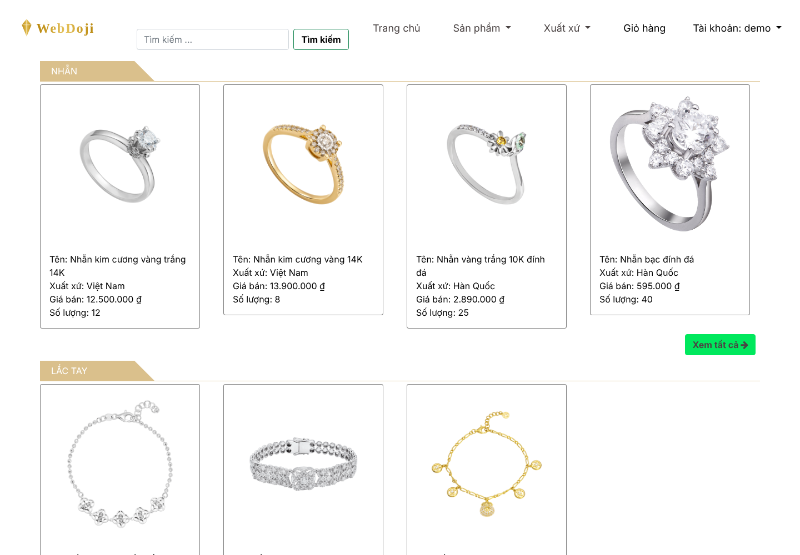
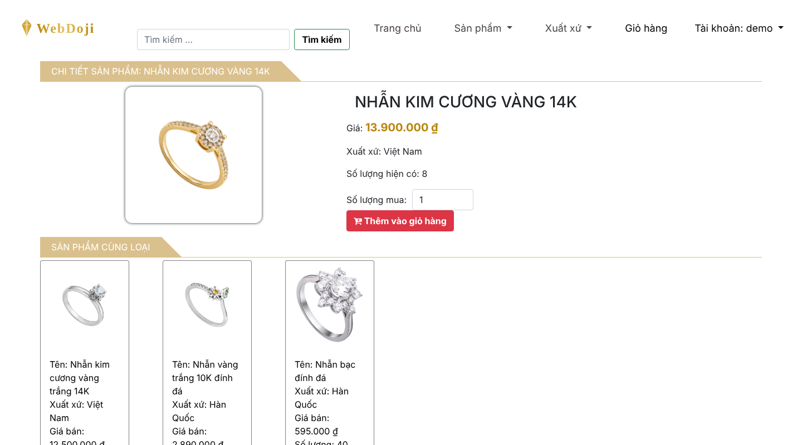
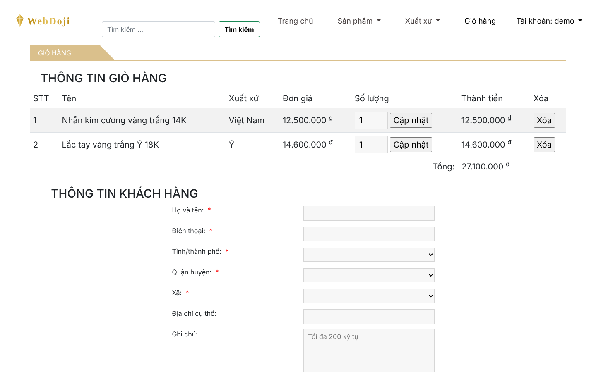
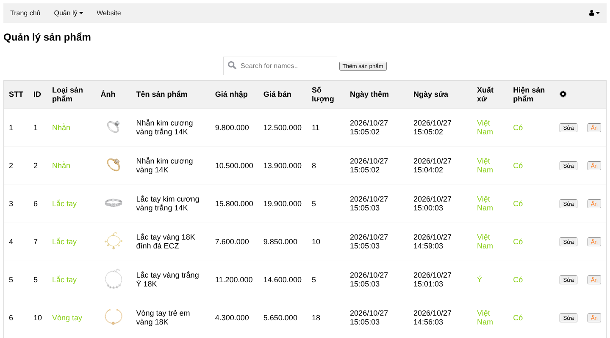
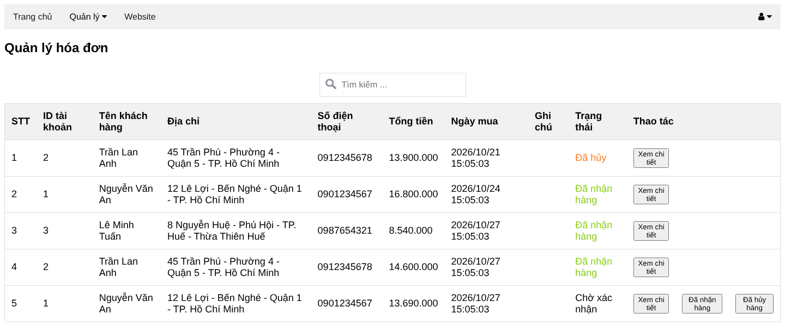

# 💍 WebDoji — Jewelry Store (Node.js + Express)


A full-stack web shop for gold and jewelry, server-rendered with Express and EJS on a MySQL database. It has a customer storefront and an admin dashboard with daily and date-range sales statistics.

<p align="center">
  
</p>

| Product detail | Cart & checkout |
|---|---|
|  |  |

| Admin — products | Admin — orders |
|---|---|
|  |  |

## ✨ Features

**Customer** (`/customer`)
- Browse by product type and origin, product detail, search
- Cart: add, update quantity, remove; checkout with province / district / ward picker
- Current orders, order details and purchase history
- Sign up, log in, change password

**Admin** (`/admin`)
- Manage products (with image upload), product types and origins — create / update / delete / show / hide
- Manage orders: view details, confirm or cancel
- Manage customers: view purchases, lock / unlock accounts
- Sales statistics for today or a custom date range (Google Charts)

## 🧱 Tech stack

| | |
|---|---|
| Runtime | Node.js, Express 4 |
| Views | EJS + express-ejs-layouts, Bootstrap |
| Database | MySQL 5.7+ / 8 or MariaDB (`mysql2`) |
| Other | express-session, cookie-parser (signed cookies), express-fileupload |

Structured as MVC: `route/` → `controller/` → `model/` (SQL queries) → `views/`.

## ▶️ Run locally

```bash
git clone https://github.com/hoanganhpy/WebDoji_Nodejs.git
cd WebDoji_Nodejs
npm install

# create the database and tables
mysql -u root -p < database/schema.sql

# load demo data (wipes existing data in dojin_nodejs)
npm run db:seed

npm start
```

Open http://localhost:3000/customer/home

| Role | URL | Username | Password |
|---|---|---|---|
| Customer | `/customer/login` | `demo` | `123456` |
| Admin | `/admin/login` | `admin` | `admin123` |

### Configuration

All settings have local defaults and can be overridden with environment variables:

| Variable | Default |
|---|---|
| `DB_HOST` / `DB_USER` / `DB_PASSWORD` / `DB_NAME` | `localhost` / `root` / *(empty)* / `dojin_nodejs` |
| `SESSION_SECRET` | `change-me-in-production` — **set this in production** |
| `PORT` | `3000` |

## 🔧 Changelog — 2026 maintenance pass

- **Security:** login cookie is now signed and only holds the user id/name (it previously stored the whole account row and could be forged)
- **Security:** cart and checkout now take prices, stock and order totals from the database instead of trusting form fields
- **Fix:** checkout form could never be submitted (an empty hidden `required` field blocked it)
- **Fix:** carts were kept in a shared in-memory array, so one user's order could include another user's items
- **Fix:** change password always failed (read a session value that was never set)
- **Fix:** locked customer accounts could still log in
- **Fix:** replaced MySQL `PASSWORD()` (removed in MySQL 8) with `SHA2(…, 256)` — accounts created with the old hash need their password reset. Unsalted SHA-256 is still not ideal; bcrypt is the next step.
- **Fix:** unknown routes now return HTTP 404; prices display as VND (`12.500.000 ₫`)
- **UI:** visible quantity input on product page, compact header, local logo instead of a hotlinked one
- **Repo:** added `database/schema.sql` + seed script; `node_modules` no longer committed

## 👥 Team

- Trần Hoàng Anh
- Võ Bá Thành Nhân
- Nguyễn Đức Đạo
